<div align="center">
  

  <br>

  <a href="https://github.com/Batuhanbey-kose/Takip_Atlasi/releases/latest/download/Takip-Atlasi.apk">
    
  </a>

  <br><br>

  <a href="https://github.com/Batuhanbey-kose/Takip_Atlasi/actions/workflows/android-ci.yml"></a>
  <a href="https://github.com/Batuhanbey-kose/Takip_Atlasi/releases/latest"></a>
  
  

  <p><strong>Takip çevrendeki değişimi bilgisayarsız, sunucusuz ve tek bakışta gör.</strong></p>
</div>

> [!IMPORTANT]
> Takip Atlası Android APK ve PC'de yerel tarayıcı arayüzü sunar. Instagram veya Meta tarafından geliştirilmemiş, desteklenmemiş ya da onaylanmamıştır. Yalnızca kendi hesabında ve sorumluluğunda kullan.

## İndirme

En güncel imzalı APK için yukarıdaki **Tek Tıkla İndir** düğmesini kullan. Bağlantı her zaman son GitHub sürümündeki `Takip-Atlasi.apk` dosyasını indirir.

Android ilk kurulumda, APK'yı açtığın uygulamaya **Bilinmeyen uygulamaları yükleme** izni vermeni isteyebilir. Yeni sürümler aynı imzayla üretildiği için APK'yı mevcut kurulumun üzerine yükleyerek verilerini koruyabilirsin.

**PC'de kullanmak için:** Kaynak kodu indir, Node.js 22 kur ve proje klasöründe `npm ci` ardından `npm start` çalıştır. `http://127.0.0.1:4173` adresini tarayıcıda aç. Yerel sunucu yalnızca bu bilgisayardan erişilir; Instagram parolası istemez ve verini başka bir sunucuya yüklemez.
**Kurulumsuz Windows paketi:** GitHub Release'teki `Takip-Atlasi-PC.zip` dosyasının tamamını bir klasöre çıkartıp `Takip-Atlasi-PC.bat` dosyasına çift tıkla. Node/npm kurulumu gerekmez; Windows 10/11 x64 ve Edge veya Chrome gerekir.
PC'de **Instagram'a bağlan (PC)** düğmesi normal Edge/Chrome penceresi açar. Girişi gerçek Instagram sayfasında tamamla, ardından Takip Atlası sayfasındaki **Listeleri tara** düğmesine bas. PC ve Android aynı liste toplayıcı kodunu kullanır; tarayıcı oturumları ayrı olduğundan iki platform ayrıca doğrulanmalıdır. Instagram 429 döndürürse PC taraması da durur ve yerel bekleme süresini korur.
PC bağlantısı hesap toplamlarını Instagram'ın güncel web profil yanıtından doğrular, web oturumunun istek başlıklarını kullanır ve 12 hesaplık sayfaları sırayla okur. Eski `accounts/current_user` sorgusunun ana sayfaya yönlendirmesini hesap bilgisi olarak kabul etmez. Profil sayaçları ile listede erişilebilen benzersiz hesap sayısı küçük farklılıklar gösterebilir.
PC kartlarında profil fotoğrafları çerez gönderilmeden CDN'den alınır ve yerel sunucuda önbelleğe konur. **Hesap bilgilerini yükle** düğmesi, görünür hesaplardan başlayarak listedeki takipçi/takip edilen/gönderi sayılarını tek tek hazırlar. Sonuçlar önbelleğe alınır; yüklemeyi durdurabilir, daha sonra devam edebilirsin. Örnek moddaki hesaplar gerçek Instagram sorgusuna gönderilmez.

> [!NOTE]
> **Play Protect indirmeyi veya kurulumu bekletirse:** Takip Atlası Google Play'de yayımlanmadığı için bazı cihazlar APK'yı `İndiriliyor...` ekranında tutabilir ya da bilinmeyen uygulama uyarısı gösterebilir. Önce sunulan **Yine de yükle** seçeneğini kullan. Bu seçenek yoksa:
>
> 1. Yalnızca yukarıdaki resmi GitHub bağlantısını kullandığından emin ol.
> 2. Play Store > profil resmi > **Play Protect** > Ayarlar bölümündeki **Uygulamaları Play Protect ile tara** seçeneğini geçici olarak kapat.
> 3. APK'yı indirip kurduktan sonra aynı seçeneği hemen yeniden aç.
> 4. Play Protect ekranındaki **Tara** düğmesiyle kontrol yap; resmi yayın APK'sında sorun bulunmamalıdır.
>
> Play Protect'i kapalı bırakma ve APK'yı başka kaynaklardan indirme.

## Neler Sunuyor?

| Takip haritası | Hesap detayları | Yerel ve özel |
|---|---|---|
| Takipçiler, takip ettiklerin ve karşılıklı hesaplar | Takipçi, takip edilen ve gönderi sayaçları | Parola Takip Atlası arayüzüne girmez |
| Seni takip etmeyenler ve senin takip etmediklerin | Profil fotoğrafları ve güvenli baş harf yedeği | Analizler yalnızca telefonda tutulur |
| Yeni takipçiler ve takibi bırakanlar | Gelişmiş sıralama, arama ve filtreleme | Reklam, analiz SDK'sı ve geliştirici sunucusu yoktur |
| Son 8 taramanın karşılaştırmalı geçmişi | 12 kalıcı görünüm teması | Uygulama içinden oturum ve veri silme |

## Nasıl Çalışır?

**PC ve Android'de güvenilir arşiv yolu:** Instagram'da **Hesaplar Merkezi → Bilgilerin ve izinlerin → Bilgilerini indir** yolundan yalnızca **Takipçiler ve takip edilenler** verisini **JSON** biçiminde iste. İndirilen ZIP'i açmadan uygulamada **Instagram ZIP / JSON arşivini seç** düğmesine bas; istersen ZIP'ten çıkardığın `followers_1.json` ve `following.json` dosyalarını birlikte seç. Kullanıcı adını profil alanına yaz. Dosya yalnızca cihazında açılır; iki liste eksikse veri kaydedilmez. Instagram arşivi güncel olmayabilir; değişim analizi yalnızca içe aktardığın kayıtların farkını gösterir.

**Android'de doğrudan bağlantı:** **Instagram'a bağlan** düğmesine bas, veri kullanım açıklamasını onayla ve açılan gerçek `instagram.com` ekranında girişini tamamla. Hesabın açılınca **Listeleri tara** düğmesine bas. Instagram'ın resmi olmayan API'si istekleri reddederse ZIP/JSON arşivi yolunu kullan.

Instagram kullanıcı adın otomatik okunamazsa başlangıç ekranındaki profil alanına yazıp tekrar dene. Uygulama adı yalnızca açık oturumun hesap kimliğiyle eşleşirse kabul eder; yeşil tik tek başına hesap doğrulaması değildir.
Hesap sorguları Instagram tarafından reddedilirse uygulama hangi sorguda hangi HTTP yanıtını aldığını gösterir. Bu hata kodları oturum çerezlerini veya hesap kimliğini içermez.
**HTTP 429** alınırsa tarama ve takip hesabı bilgisi istekleri durur; Instagram'ın `Retry-After` süresi, belirtilmediyse 15 dakikalık yerel bekleme uygulanır. Bekleme bittikten sonra da Instagram erişimi reddedebilir; süre bir başarı garantisi değildir. **HTTP 400** tek başına hatanın sebebini açıklamaz; tanınan istemci uyumsuzluğu veya giriş doğrulama yanıtları ayrıca belirtilir.

Takibi bırakanları ve yeni takipçileri görebilmek için farklı zamanlarda en az iki tarama gerekir. Takip taraması ve hesap sayaçları otomatik çalışmaz; bildirim veya periyodik arka plan kontrolü yoktur. Sayaçlar için listedeki **Hesap bilgilerini yükle** düğmesine bas. Web profil bilgileri tek tek, aralarında yaklaşık 1,5–2,2 saniye bekleyerek hazırlanır ve önbelleğe alınır. Yüzlerce hesabın tamamını hazırlamak zaman alır; görünenler önceliklidir, yükleme durdurulabilir. Sayaç tabanlı sıralama ve filtrelerde eksik bilgiler olabileceği gösterilir.

**Tarama temposu:** Varsayılan **Temkinli** seçeneğinde her Instagram isteğinden önce 2–3 saniye beklenir; sayfa başına 50 hesap istenir. Açılır menüden **İlk sürüm** (1,1–2 saniye) veya **Bir kademe hızlı** (0,9–1,5 saniye) seçebilirsin. İlk sürüm temposunda sorunsuz tarama doğrulanmadan daha hızlı seçeneğe geçme. Tempo otomatik yükseltilmez; hiçbir seçenek Instagram'ın hız sınırına takılmayacağı garantisini vermez.

## Gizlilik

- Instagram parolası Takip Atlası tarafından okunmaz veya saklanmaz.
- Oturum çerezi yalnızca tam `https://www.instagram.com` API isteklerine gönderilir.
- Profil fotoğrafı çerez kullanılmadan doğrudan izin verilen Instagram CDN alanlarından alınır.
- Android bulut yedeklemesi ve cihazlar arası sistem aktarımı kapalıdır.
- Yerel analiz geçmişi, fotoğraf önbelleği ve uygulama içi oturum tek işlemle silinebilir.

Tam açıklama uygulamanın içindeki **Gizlilik ve veri kullanımı** bölümünde bulunur.

## Teknoloji

`Java` · `Capacitor 7` · `Android WebView` · `Node.js` · `fflate` · `IndexedDB` · `GitHub Actions`

<details>
<summary><strong>Kaynaktan derleme</strong></summary>

Android APK için gereksinimler: Node.js 22, Android Studio, JDK 21 ve Android SDK.

```powershell
npm ci
npm run check
npm test
npm run desktop:smoke
npm run android:sync
cd android
.\gradlew.bat testDebugUnitTest lintDebug assembleDebug
```

`www` hem PC yerel sunucusu hem de Capacitor Android WebView tarafından kullanılan ortak arayüzdür.

</details>

<details>
<summary><strong>İmzalı GitHub Release hazırlama</strong></summary>

Yerel release anahtarı bir kez oluşturulur:

```powershell
powershell -ExecutionPolicy Bypass -File scripts\create-android-signing-key.ps1
```

`android\github-release.jks` ve `android\keystore.properties` birlikte ve güvenli biçimde yedeklenmelidir. Bu dosyalar Git tarafından yok sayılır. `v*` etiketi gönderildiğinde `.github/workflows/android-release.yml` testleri çalıştırır, APK'yı aynı anahtarla imzalar ve GitHub Release'e ekler.

</details>

## Sorumluluk

Android doğrudan bağlantısı takip listesi ve herkese açık hesap bilgilerini resmi olmayan Instagram uçlarından okur. Instagram değişiklikleri bu özelliği bozabilir veya hız sınırı uygulayabilir. ZIP/JSON arşiv içe aktarma bu uçlara bağlanmaz. Kaynak kodunu ve APK'yı kullanma sorumluluğu kullanıcıya aittir.

<div align="center">
  <sub>Takip Atlası · Android'de yerel takip analizi</sub>
</div>
